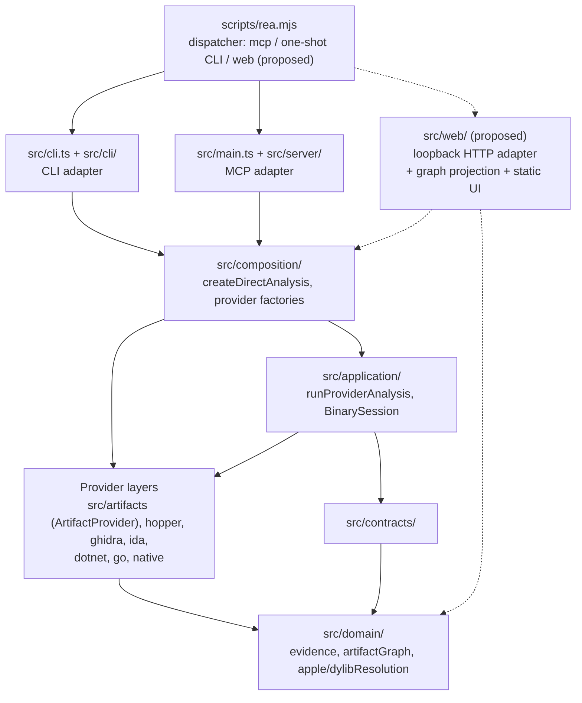

# REA project discovery

This document records what was learned about the repository before proposing
changes. Every statement about the code was checked against the source named in
parentheses. Statements that could not be verified are marked as unknown.

## Purpose

REA is a local-only reverse-engineering tool with shared CLI and MCP workflows
(`AGENTS.md`, "Product and Authority"). Its central rule is to distinguish
observations, derivations, inferences, and unknowns, and to preserve Evidence
provenance and session semantics through both adapters. Provider support and
setup are documented in `README.md` and its linked guides.

## Tech stack

| Concern            | Choice                                                                                                                                                                | Source                                              |
| ------------------ | --------------------------------------------------------------------------------------------------------------------------------------------------------------------- | --------------------------------------------------- |
| Runtime            | Node 22.19+, 24.11+ or 26+ (`.nvmrc` pins the toolchain); ESM (`"type": "module"`)                                                                                    | `package.json#engines`, `#type`                     |
| Language           | TypeScript compiled by `tsconfig.build.json` (`rootDir: src`, tests and fixtures excluded) into `dist/`                                                               | `tsconfig.build.json`                               |
| Schemas            | `zod` for contracts, configuration and boundary parsing                                                                                                               | `src/contracts/`, `src/domain/*Schema`              |
| CLI                | `incur` (`createCli`) behind the `scripts/rea.mjs` dispatcher                                                                                                         | `scripts/rea.mjs`, `src/cli.ts`                     |
| MCP                | MCP SDK stdio server                                                                                                                                                  | `src/main.ts`, `src/server/`                        |
| Tests              | `vitest` projects: `domain`, `services`, `adapters`, `composition`, `conformance`, `evaluation`, boundary and acceptance lanes                                        | `vitest.config.ts`, `docs/testing.md`               |
| Lint and structure | `oxlint`, `knip`, `scripts/verify-module-boundaries.mjs`, `jscpd`                                                                                                     | `package.json` scripts                              |
| Task runner        | `turbo` (`typecheck`, `lint:built`, `knip`, `test:run`, ...)                                                                                                          | `package.json`, `turbo.json`                        |
| Packaging          | `files: ["dist", ...]`; `scripts/bundle-runtime.mjs` (rolldown) bundles only `dist/mcp` and `dist/cli-runtime`; `scripts/prepack.mjs` lists required compiled entries | `scripts/bundle-runtime.mjs`, `scripts/prepack.mjs` |

`scripts/rea.mjs` is the executable (`bin.rea`, `bin.rea-agents`). It decides the
mode before importing `incur`: `mcp` or `--mcp` loads `dist/mcp/main.js`,
`mcp doctor` loads `dist/mcp/main.js` plus `dist/cli-runtime/mcpDoctor.js`, and
everything else loads `dist/cli-runtime/cli.js` and runs the CLI. It first checks
that the compiled files exist and otherwise prints a rebuild instruction.

## Layered architecture

Dependencies flow inward (`AGENTS.md`, "Architecture and Cleanup"):

1. `src/domain/` and `src/contracts/` - pure, side-effect-free semantics and
   caller-visible schemas.
2. Provider layers - `src/artifacts/`, `src/hopper/`, `src/ghidra/`, `src/ida/`,
   `src/dotnet/`, `src/go/`, `src/native/`, `src/wasm/`, and others.
3. `src/application/` - shared CLI/MCP workflows (`DirectAnalysis`,
   `BinarySession`, `AnalysisProviderRegistry`, investigation records).
4. Adapters - `src/cli.ts` + `src/cli/` (one-shot CLI), `src/main.ts` +
   `src/main/` + `src/server/` (MCP stdio).
5. `src/composition/` - the composition root. Factories construct fresh
   providers and sessions without starting engines or acquiring targets.

`scripts/verify-module-boundaries.mjs` enforces resolved import boundaries (see
`scripts/lib/module-boundaries.mjs`): `domain` and `contracts` may not import
other src layers; `application` may not import `composition`; `application` and
`server` may not construct providers (for example
`src/artifacts/ArtifactProvider`) directly. Anything that needs a provider
reaches it through `src/composition/`.

Dotted edges are proposed. The web adapter sits beside the CLI and MCP adapters:
it calls the same bound `runProviderAnalysis` from `src/composition/` and parses
the result with domain schemas; it does not add provider logic.

## Evidence model

`src/domain/evidence.ts` owns the Evidence record (`evidenceSchema`,
`parseEvidence`, `createEvidence`). Verified fields:

- `evidence_id` (`ev`-prefixed digest, checked against the record's semantic
  identity), `subject` (name, sha256 digest, detected `format`, `architecture`,
  `local_path`) or `null`, `provider` (`id`, `name`, `version`),
  `analysis_profile`, `predicate_type`, `operation`.
- `confidence`: exactly one of `observed`, `derived`, `inferred`.
- `limitations: string[]`, `locations` (address, address-range, artifact-path,
  file-offset, file-offset-range), `evidence_links` (other Evidence ids), an
  authority enumeration (`shipped-artifact`, `controlled-replay`, ...), an
  optional execution environment, and the typed `normalized_result`.
- Coverage is modeled explicitly per result. Examples: `ArtifactInventoryResult`
  has `coverage_status` (`complete` | `partial`, optional only on legacy
  persisted Evidence), `DylibResolutionResult.coverage` has `status`,
  `unparsed_images` and `roots_without_architecture`, and
  `relationshipCoverageSchema` expresses `complete` | `partial` | `unknown` with
  reasons. Missing coverage is unknown, not absence (`docs/tool-design.md`).

The shared one-shot workflow `runProviderAnalysis(path, tool, arguments, logger,
signal)` (`src/application/DirectAnalysis.ts`, bound by
`createDirectAnalysis(environment)` in `src/composition/directAnalysis.ts`)
returns a `JsonValue`. On success it is the Evidence JSON; on a modeled failure
it is `{ "error": "Analysis failed", ...projectAnalysisError(error) }` (the
`cliError` helper). Each call opens a fresh `BinarySession`, executes one
operation and always releases resources (`withSessionCleanup`), with
cleanup-failure reporting through `directAnalysisCleanupFailure`. An optional
`AbortSignal` cancels the run. Consumers therefore must discriminate on the
`error` key and parse the success branch with `evidenceSchema` before use.

## Providers

REA has two kinds of capability:

- Deep providers: Hopper, Ghidra and IDA (`src/hopper/`, `src/ghidra/`,
  `src/ida/`) provide disassembly, decompilation, xrefs and call graphs. They
  are bring-your-own, require installation, and Ghidra uses ephemeral databases
  while IDA analysis is read-only (`AGENTS.md`). They are selected by
  `AnalysisProviderRegistry` deterministically without fallback.
- Provider-free static operations: `ArtifactProvider`
  (`src/artifacts/ArtifactProvider.ts`) implements read-only inventory and
  format operations with no external engine, including `inspect_artifact`,
  `trace_dylib_resolution`, `inspect_asset_catalog`, `inspect_keyed_archive` and
  `decode_interface_builder`. Static Go, PE and managed .NET inspection
  (`src/go/`, `src/dotnet/`, `src/native/`) are also available without a deep
  provider. `ArtifactClient.traceDylibResolution` refuses any target that is not
  a Mach-O or `.app` bundle with `AnalysisUnsupportedTargetError`
  ("requires an active Mach-O or .app bundle target").

Because the first web release needs no deep provider, it works on a machine with
nothing installed beyond REA itself.

## Graph-capable outputs inventory

| Output                                  | Owner                                                                     | Nodes / edges                                                                                                                                                                                    | Deep provider needed    | Used by web v1               |
| --------------------------------------- | ------------------------------------------------------------------------- | ------------------------------------------------------------------------------------------------------------------------------------------------------------------------------------------------ | ----------------------- | ---------------------------- |
| `inspect_artifact` inventory            | `src/domain/artifactGraph.ts` (`ArtifactInventoryResult`)                 | `nodes` (content-addressed artifacts), `occurrences` (paths), `edges` with `relation` in `contains`, `extracts`, `slice-of`, `embeds`, `loads`, `maps-source`, `derived-from`; `coverage_status` | no                      | yes (`artifact-containment`) |
| `trace_dylib_resolution`                | `src/domain/apple/dylibResolution.ts` (`DylibResolutionResult`)           | `roots`, `images`, `edges` (load command, weak/upward/reexport/delayed_init flags, candidates, resolution `resolved`/`conditional`/`unresolved`/`undetermined`), `findings`, `coverage`          | no                      | yes (`dylib-dependencies`)   |
| Interface Builder graph                 | `src/domain/apple/interfaceBuilderGraph.ts`                               | UI object graph                                                                                                                                                                                  | no                      | no                           |
| Managed application graph               | `src/domain/managed/managedApplicationGraph*.ts`                          | .NET project graph                                                                                                                                                                               | no                      | no                           |
| JavaScript application graph            | `docs/javascript-application-graph.md`, `src/domain/javascript/`          | modules and imports                                                                                                                                                                              | no                      | no                           |
| Native investigation graph / call paths | `src/domain/native/nativeInvestigationGraph.ts`, `src/domain/callPath.ts` | functions, xrefs, call edges                                                                                                                                                                     | yes (Hopper/Ghidra/IDA) | no (later)                   |

## Conventions

- Conventional Commit subjects and PR titles; `!` or a `BREAKING CHANGE:` footer
  for breaking changes (`AGENTS.md`).
- Fail-closed scope rule (`CONTRIBUTING.md#contribution-scope`): if scope fit,
  authority, side effects, or required verification are materially unresolved,
  do not merge, enable, or distribute the capability. Early proposals, small
  prototypes and draft PRs are welcome but do not authorize integration.
- Local-only: no remote analysis service. Preserve caller-selected inputs and
  local evidence (paths, digests, metadata); redact only transport credentials
  and explicitly marked sensitive values.
- Normalize once at the owning boundary with format-aware parsers; consumers use
  the owner's parsed facts. Model expected failures with the tagged error
  algebra and `Result`.
- Tool and interface design follows `docs/tool-design.md` (analyst question
  first, return the smallest sufficient answer with provenance, limits follow
  real constraints). Tests follow `docs/testing.md` (prefer public workflows,
  report unverified coverage, simulated providers do not establish real-provider
  behavior).
- Checks: `npm run check:fast`, `npm run test:local -- PATH...`,
  `npm run test:focused -- PATH...`, `npm run verify:test-discovery` after
  adding tests, `npm run docs:check`; `npm run check:pr` is optional.
- Tracked outputs: `docs/public/product-catalog.json`, managed conformance
  files and `skills/` are generated and ignored; never commit binaries, `dist/`
  or credentials.

## Discovery findings relevant to a web UI

1. No HTTP server exists today. The only long-lived adapter is MCP over stdio;
   browser-facing code under `src/browser/` and `src/inspector/` is a client of
   other servers, not a server of REA. A new listener is a new attack surface and
   needs explicit loopback, authentication and header guards.
2. No graph layout or rendering library is a dependency, and the project is
   strict about unlisted dependencies (`knip` rules `dependencies`,
   `unlisted` set to `error`). A web UI should avoid new dependencies; a small
   hand-written layered SVG layout is sufficient for the two graph kinds.
3. The shared workflow already returns everything needed: `runProviderAnalysis`
   for `inspect_artifact` and `trace_dylib_resolution`. The web adapter needs no
   new analysis capability and no deep provider.
4. Domain graph types (`ArtifactInventoryResult`, `DylibResolutionResult`) are
   already parsed by their owners. The web projection must consume those parsed
   types instead of re-reading raw JSON or bytes.
5. Wiring that a new `src/web/` directory requires:
   - `knip.json` `entry` lists `src/main.ts` and `src/cli.ts`; a new
     `src/web/main.ts` entry must be added or its files are reported unused.
   - `vitest.config.ts` `adapters` project includes a fixed directory glob
     (`src/{apktool,jeb,adb,artifacts,...,windows}/**/*.test.ts`); `web` must be
     added or tests there will not run (`npm run verify:test-discovery` guards
     this).
   - `scripts/verify-module-boundaries.mjs` applies to `src/web/`; the adapter
     must reach providers only via `src/composition/`.
   - `scripts/rea.mjs` needs a `web` mode and its compiled-file existence check;
     `scripts/bundle-runtime.mjs` / `scripts/prepack.mjs` currently know only
     `mcp` and `cli-runtime`, so `dist/web/main.js` ships unbundled unless
     extended.
   - `docs/architecture.mermaid`, `docs/cli.md` and a new `docs/web-ui.md`
     describe entry points and must be updated.
6. Dispatching `rea web` as a mode in `scripts/rea.mjs` (like `mcp`) avoids
   changing the generated CLI command catalog (`CLI_COMMANDS`,
   `src/cliCommandNames.ts`).
7. Unknown at discovery time: how maintainers want a non-MCP, non-CLI
   network-listening adapter classified under the scope rule, and whether the
   `web` mode should be bundled. Both are recorded as open questions in the
   proposal.
